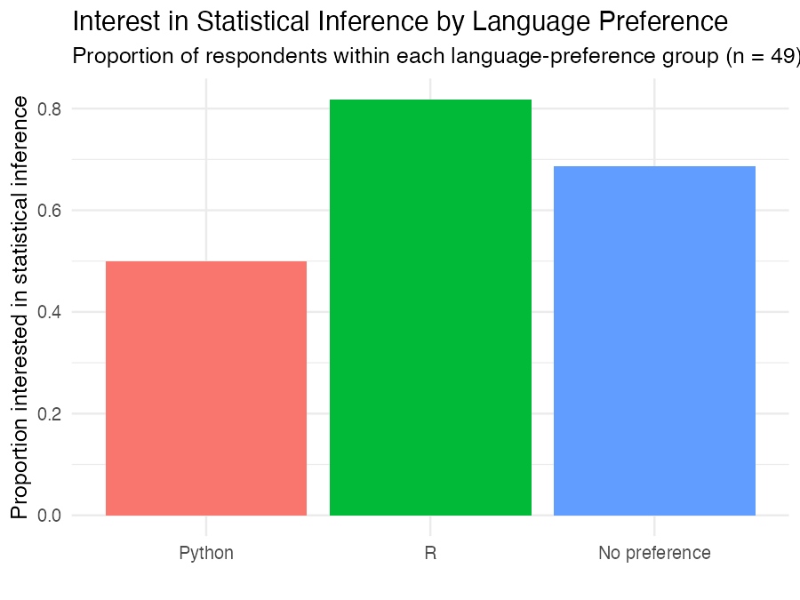
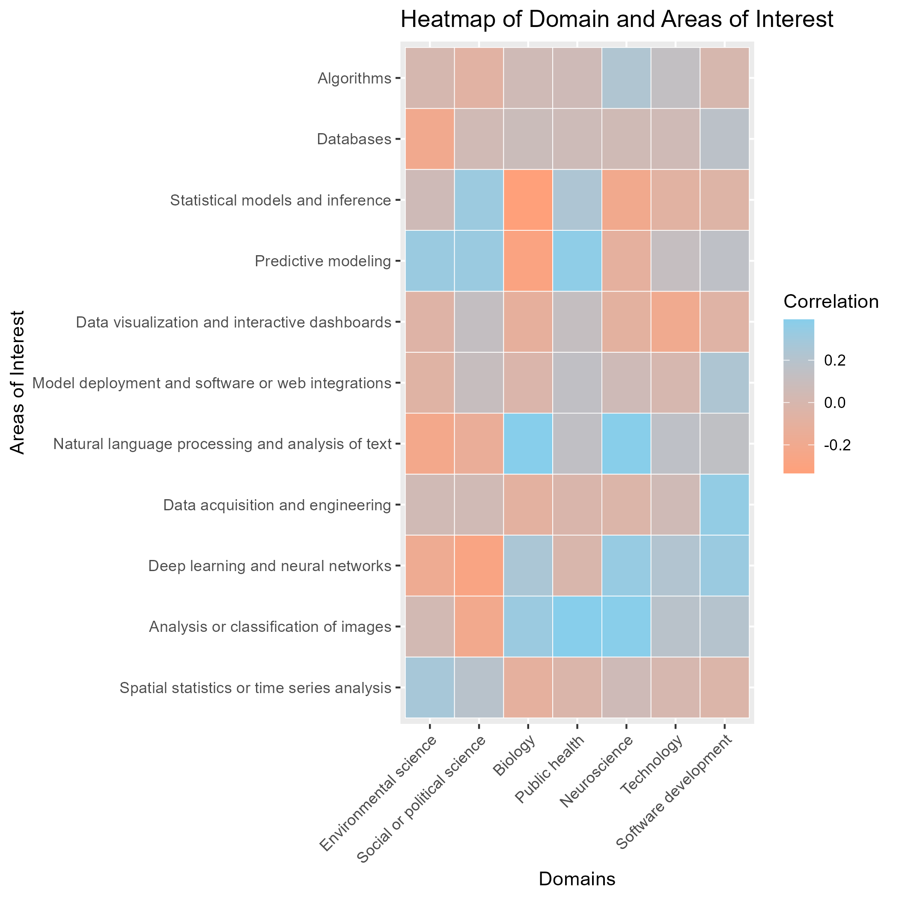
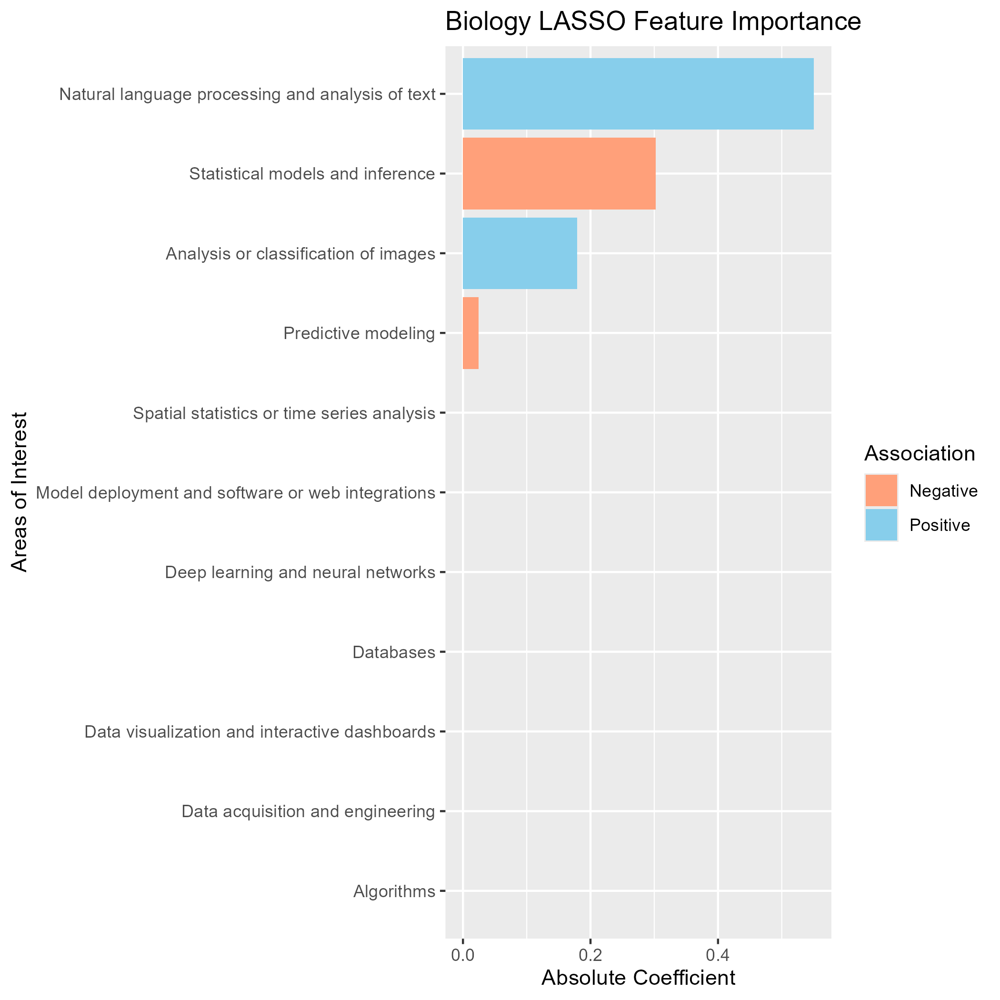
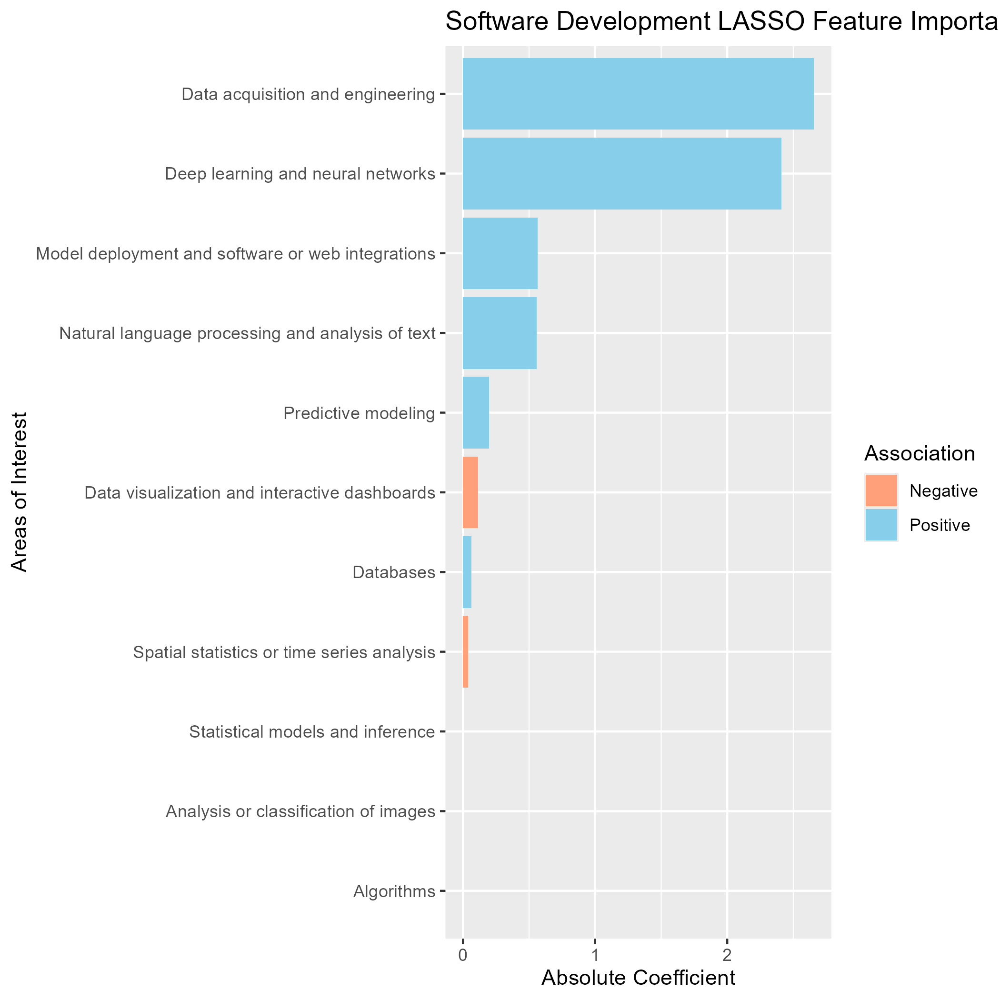
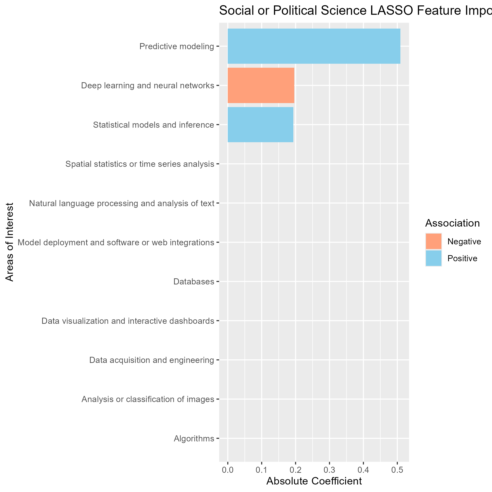
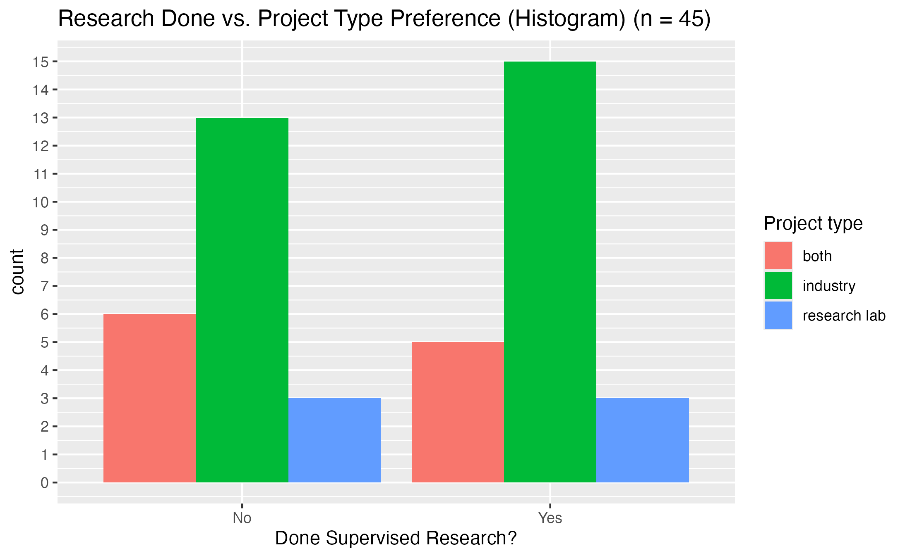
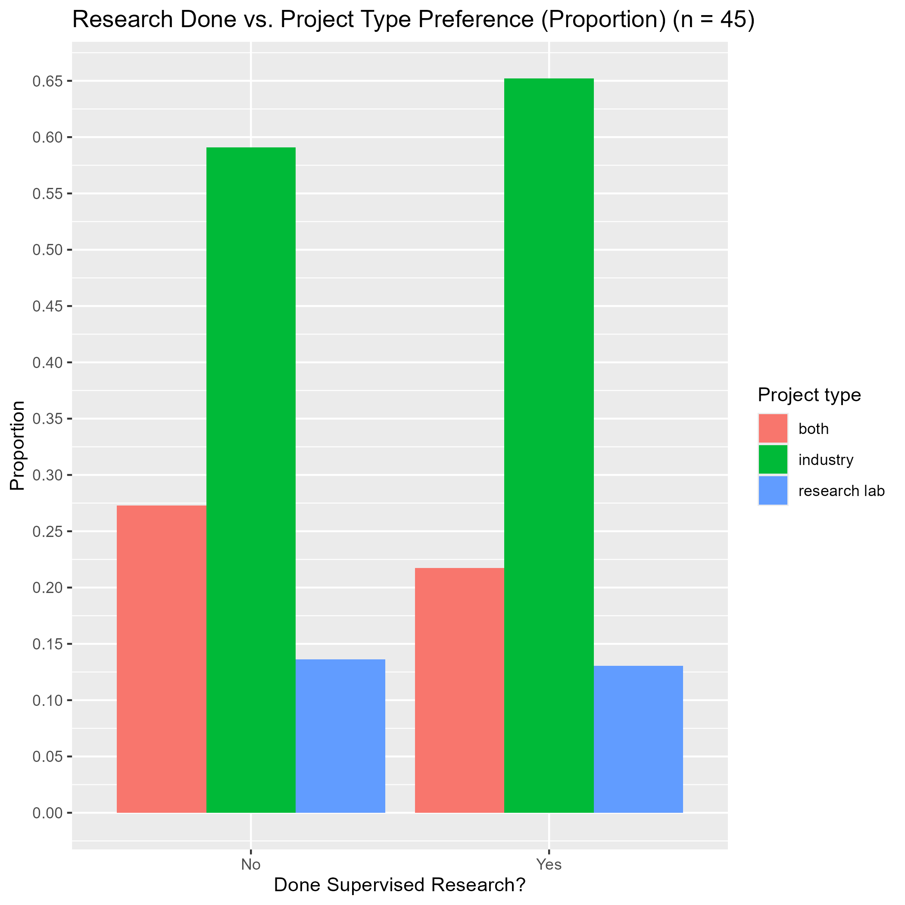
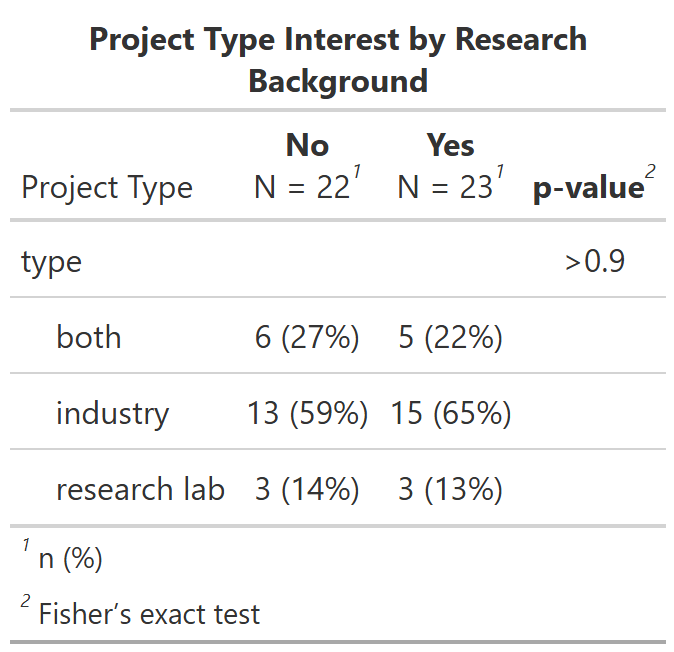

```{r}
# load any other packages and read data here
library(tidyverse)
library(kableExtra)
```

## Executive summary

We analyzed survey responses from 49 students to see how their data science interests were affected by their domains and programming language preferences, as well as how their research background affected their project type preferences. We first sought to see if there was a relationship between students' areas of interest and domain specialization. Using lasso logistic regression among a few select domains against all available areas of interest as features, we found that natural language processing (NLP) was strongly associated with a Biology specialization, data acquisition and engineering and deep learning for Software, and predictive modeling for Social and Political Science. Secondly, we used logistic regression to test to see if there is an association between an interest in statistical inference and programming language preferences. Relative to students who preferred Python, we found that students that preferred R had an odds ratio of 4.5 (p = 0.09) and students that had no preference had an odds ratio of 2.2 (p = 0.25). However, both odds ratios were imprecise with wide confidence intervals and had a p-value above 0.05 so neither result was statistically significant. Third, we focused on whether students with a background in research affected their preference in project types, it was found that all students regardless of research background skewed towards industry (65% of those that had research experience, and 61% that did not). A Fisher's exact test was run and concluded that there was no evidence of an association (p \> 0.9, n = 45); this test had a sample size of n = 45 after conjoining the two data sets. Due to the small sample size, and the fact that the responses are self-reported, these results are largely exploratory and can only detect large patterns.

## Data description

This data was taken from a self-reported intake form from all the students enrolled in the PSTAT 197A course of 2026. The majority of the data from self-reported form was split into two categories: background and interests, and stored into data sets `backgroud-clean.csv` and `interests-clean.csv`. Demographic information and response times were stored in different data sets: `class-summary.csv` and `survey-metadata.csv`. Of the total 55 students in the class, 51 consented to having their background information used for analysis, 49 consented to having their interests used for analysis, 49 consented to both, 2 did not consent to either. For the purpose of this particular analysis, `background-clean.csv` and `interests-clean.csv` are primarily focused on and covered. Both data sets were given artificial identifiers stored as `response_id` which was also used to conjoin the data sets for analysis.

A summary of the main characteristics of `background-clean.csv` can be seen here:

+----------------------------+---------------------------------------------------------------------------------------------------------------------------------------------------------------------------------------------+
| Variable                   | Description                                                                                                                                                                                 |
+============================+=============================================================================================================================================================================================+
| `[skill].comf`             | A numerical scale of 1-5 which measures how the student rates their comfortability with the respective skill.                                                                               |
|                            |                                                                                                                                                                                             |
| e.g., prog.comf, math.comf | The skills: prog \[programming\], math, stat \[statistics\]                                                                                                                                 |
+----------------------------+---------------------------------------------------------------------------------------------------------------------------------------------------------------------------------------------+
| `[skill].prof`             | An ordinal variable which goes: beg \[beginning\], int \[intermediate\], adv \[advanced\]. This measures how the student rates their proficiency with the respective skill.                 |
|                            |                                                                                                                                                                                             |
| e.g., prog.prof, math.prof |                                                                                                                                                                                             |
+----------------------------+---------------------------------------------------------------------------------------------------------------------------------------------------------------------------------------------+
| `upper_div_courses`        | An ordinal variable that groups the number of upper division courses in statistics, math, and programming that the student has taken.                                                       |
+----------------------------+---------------------------------------------------------------------------------------------------------------------------------------------------------------------------------------------+
| `courses`                  | A character that contains a list of the specific courses that the student has completed.                                                                                                    |
+----------------------------+---------------------------------------------------------------------------------------------------------------------------------------------------------------------------------------------+
| `domain_specialization`    | A yes or no answer to whether the student has any domain specialization.                                                                                                                    |
+----------------------------+---------------------------------------------------------------------------------------------------------------------------------------------------------------------------------------------+
| `research`                 | A categorical variable which contains: yes, no, and unsure. Answers to whether the student has had experienced with supervised research in a setting outside of class or personal projects. |
+----------------------------+---------------------------------------------------------------------------------------------------------------------------------------------------------------------------------------------+

A summary of the main characteristics of `interests-clean.csv` can be seen here:

| Variable | Description |
|----|----|
| `type` | A categorical variable that contains the student's preference for their project type. Contains: ind \[industry\], lab \[research lab\], both |
| `language` | A categorical variable that contains the student's programming language preference. Only contains: R, Python, No preference |
| `domains` | A character that contains a list of the domains that the student had selected as their specialization |
| `areas` | A character that contains a list of the areas of interest in data science that the student had selected. |

## Questions of interest

We wanted to understand how data science interests were affected by a student's domain specialization and programming language preferences. We also wanted to see whether a student's project type preference was affected by whether they had prior research experience.

Our analysis addressed three questions:

1.  Does programming language correlate with students’ interest in statistical inference?
2.  Do students’ domains correlate with students’ preferences in the area of interest?
3.  Are students that have done supervised research (not related to class or personal project) more interested in research labs than industry or not?

## Findings

### Findings for Q.1



We first grouped students by their programming language preference and plotted the proportion of each group's interest in statistical inference. 81.8% of R-preferring students expressed interest in statistical inference, compared to 68.8% of those with no preference, and 50.0% who preferred Python.

```{r Display Log-Regression Model Results}
library(broom)
interest <- read_csv('../data/interest-clean.csv', show_col_types = FALSE)

d <- interest %>%
  mutate(
    language = factor(language, levels = c('Python', 'R', 'No preference')),
    interested_stat_inference = str_detect(areas, fixed('Statistical models and inference'))
  )


model <- glm(interested_stat_inference ~ language, data = d, family = 'binomial')

model_results <- tidy(model, exponentiate = TRUE, conf.int = TRUE) %>%
  filter(term != '(Intercept)') %>%
  mutate(term = str_remove(term, 'language')) %>%
  select(language_vs_python = term, odds_ratio = estimate,
         ci_low = conf.low, ci_high = conf.high, p.value) |>
  rename(
    "Language vs. Python" = language_vs_python,
    "Odds Ratio" = odds_ratio,
    "CI Lower Bound" = ci_low,
    "CI Upper Bound" = ci_high,
    "P-value" = p.value
  )

kable(model_results, caption = "Table 1. Logistic Regression Model for Language Against Interest") |>
  kable_styling()
```

R-preferring students had 4.5 times the odds of Python-preferring students of being interested in statistical inference (95% CI: 0.90 to 34.2; p = 0.091). Additionally, students with no preference in language had 2.2 times the odds of Python-preferring students (95% CI: 0.59 to 9.01; p = 0.251). However, neither of these results reached the threshold of p \< .05. and the confidence intervals were significantly wide. The sample for this test is small (N = 49), especially the R-preference group (n=11). Therefore, confidence intervals are wide and both include 1, indicating that the data is compatible with no difference as well as with a large one. These results are best reported as a trend, rather than a confirmed effect.

This relationship between language preference and interest in statistical inference is expected, but the evidence is not strong due to the small sample size, neither comparison being statistically significant, and the confidence intervals being wide enough to have no difference at all. Since there are only 11 students that reported preferring R as a programming language, one or two different answers could noticeably change the estimated odds ratio. One reason for this relationship could be that students who are already more interested in statistics may be more likely to choose R, a language that was built for statisticians. Another reason could be that since most courses at UCSB only use and teach in R, students may just feel more comfortable in this language in general.

### Findings for Q.2

{width="55.6cm"}

The initial investigation for domain specializations and areas of interests was started by selecting the primary domains to focus on. 7 out of the 15 domains were selected with the cutoff being at least 20 students reporting that domain. The heat map was then used to select which domains to proceed with lasso logistic regression by selecting domains with clear visible biases towards one interest or another. Biology and social/political science had opposite correlations for a majority of the areas of interest. Software development was also added as the 3rd domain because intuition would suggest that it is unrelated with biology or social/political science and the correlated areas of interest would differ.

::: {layout="[[1,1],[1]]"}





:::

While correlation shows how one area of interest is related to one domain, the logistic regression uses all 11 areas at once as predictors to predict if a student stated interest in the domain. We did three separate models, one for each of the Biology, Software Development, and Social/Political Science domains highlighted in the correlation analysis. Lasso regularization was applied because it aggressively shrinks some coefficients to zero, so we can look at which areas of interest (our predictors) are the most useful for the model. It is important to clarify that when LASSO shrinks a coefficient to zero, it does not mean that the area of interest is unrelated to the domain. Additionally, a 5-fold cross validation was applied to choose the penalty value. The predictors are then ranked on a graph by how large the absolute coefficient is, signalling how important the area of interest was for predicting whether a survey respondent selected a domain. These methods were chosen in consideration of the small sample size (n=49), and for the purposes of exploratory analysis, as opposed to accurate predictions. Thus there is no training/testing split and no model performance evaluation.

For the models, NLP has the highest feature importance for Biology, Data acquisition and engineering and Deep Learning for software development, and Predictive modeling for Social and Political Science. Once again, the model does not show that these fields are necessarily the most important for the corresponding domains, it simply shows that there is an association between selecting a certain area of interest and selecting a domain within our sample. One interesting finding is, although while the top associations seem to match with real life relations, such as using NLP for genomic sequencing in Biology, or how Data acquisition is the first step in many software development pipelines, there are also results from the sample that do not match expectations. For instance, people interested in databases might be interested in software development because databases are frequently used within the domain, but the feature was not important in our model. These results show that the associations between areas of interest and domains reflect tendencies of respondents in the sample. Moreover, there are similarities and differences between the correlation strengths and the weights assigned to the areas from the logistic regression. Thus, the methods and models chosen for exploratory analysis affect the results on how the sample data is portrayed.

### Findings for Q.3

::: {layout="[1,1]"}



:::

Compared to the other 2 questions, this analysis contains a smaller sample size (n = 45). Among the 51 respondents, 2 were dropped due to having no available responses to their project type, and 4 were dropped for holding the response “unsure” under research background. “Unsure” was decided to be dropped due to the low number of respondents that answered, and also to simplify the analysis. 

Industry type projects were the majority selected across students that had and had not done supervised research-with only 6 participants selecting research labs and 11 selecting both. Despite the nearly even split of research backgrounds, an extreme bias to industry is presented. Although, from the distribution of the proportion graph and the histogram, it can be seen that marginally more students that had done supervised research selected industry as their preferred project type.

{width="15cm"}

In order to confirm if there is any relationship between the two variables, Fisher’s exact test was run with a significance level of 0.05 since the expected frequency for each group below the suggested 5 for a chi-square test. The assumptions required by the Fisher test are that the variables are independent, and that the values within the contingency table are fixed; all variables had met the assumptions. A p-value of 1 was produced by the test, and thus there was no significant evidence to reject the hypothesis that there is no association between the two variables. Thusm e can see that students with research experience were not more likely to prefer research projects; research-only preference was nearly identical across groups (3 of 22 vs. 3 of 23).

## Limitations

There were a few limitations to all 3 questions. The sample sizes were small (n = 49 for Q1 and Q2) and (n = 45 for Q3), and the R group in Q1 in particular has only 11 students. Therefore, the estimates are imprecise and the analysis has low power to detect moderate differences.

### Q1.

In Q1, the non-significant results are not evidence of having no effect. It means that the data is inconclusive. Also, interest was measured by whether students ticked a box on a checklist, so a student who did not select statistical inference may still be interested in it. Furthermore, we did not account for other factors that could influence both language preference and interest, such as prior coursework, major, or instructor. Finally, we focused on one area after initially exploring three. Because that choice was informed by the data, the p-values should be read as descriptive rather than as confirmatory tests.

### Q2.

Correlations show tendencies of respondents in this sample and don't show causation. They also don't show which areas matter most to a specific domain. Also, correlation and LASSO weights don't always agree, so conclusions depend on how the data is modeled.

### Q3.

It should be noted that respondents that answered “unsure” under their research background could denote a borderline experience to supervised research or that the student answered falsely. However, it was decided that it was not statistically significant in altering the distribution of answers after experimenting with the inclusion of the answer. Additionally, several of the groups were extremely small with only 6 students preferring research projects. So, the proportions will shift significantly if one or two of the students answer differently. We also had to drop several respondents due to unavailable data and the classification of "unsure" as negligible. The variables are also self-reported, and students may interpret “supervised research” differently, causing the data to be incorrect. Finally, research experience could shape project preference, but students already interested in research may also be the ones who seek it out, and factors such as year in school, major, or GPA could affect both.

```{r Q1 prep, eval = FALSE}
interest <- read_csv('../../data/interest-clean.csv', show_col_types = FALSE)

d <- interest %>%
  mutate(
    language = factor(language, levels = c('Python', 'R', 'No preference')),
    interested_stat_inference = str_detect(areas, fixed('Statistical models and inference'))
  )

nrow(d)
count(d, language)
```

```{r Q1 figure, eval = FALSE}
fig <- d %>%
  group_by(language) %>%
  summarise(proportion = mean(interested_stat_inference), n = n()) %>%
  ggplot(aes(x = language, y = proportion, fill = language)) +
  geom_col() +
  labs(title = 'Interest in Statistical Inference by Language Preference',
       subtitle = 'Proportion of respondents within each language-preference group (n = 49)',
       x = '', y = 'Proportion interested in statistical inference', fill = 'Language preference') +
  theme_minimal(base_size = 12) +
  theme(legend.position = 'none')

fig
ggsave('../../results/figures/language-vs-statinference.png', fig, width = 6, height = 4.5, dpi = 150)
```

```{r Q1 model, eval = FALSE}
model <- glm(interested_stat_inference ~ language, data = d, family = 'binomial')

model_results <- tidy(model, exponentiate = TRUE, conf.int = TRUE) %>%
  filter(term != '(Intercept)') %>%
  mutate(term = str_remove(term, 'language')) %>%
  select(language_vs_python = term, odds_ratio = estimate,
         ci_low = conf.low, ci_high = conf.high, p.value)

model_results
```

```{r Q2 key, eval =FALSE}
all_areas <- c("Spatial statistics or time series analysis", "Analysis or classification of images", "Deep learning and neural networks", "Data acquisition and engineering", "Natural language processing and analysis of text", "Model deployment and software or web integrations", "Data visualization and interactive dashboards", "Predictive modeling", "Statistical models and inference", "Databases", "Algorithms")

all_domains <- c("Environmental science", "Social or political science", "Biology", "Public health", "Neuroscience", "Technology", "Software development","Ecology", "AI", "Sports/Economics/Finance", "Music", "Defense", "Economics", "Quantitative Finance", "Financial Markets")

main_domains <- c("Environmental science", "Social or political science", "Biology", "Public health", "Neuroscience", "Technology", "Software development")
```

```{r Q2 plot freq, eval = FALSE}
has_area <- sapply(all_areas, grepl, interest$areas)
area_counts <- colSums(has_area)

area_df <- data.frame(count = area_counts, areas = names(area_counts))

ggplot(area_df, aes(x = count, y = reorder(areas, count))) + geom_col() + labs(y = "Areas of Interest")
```

```{r Q2 plot domains freq, eval = FALSE}
domain_counts <- colSums(sapply(all_domains, grepl, interest$domains))

domain_df <- data.frame(count = domain_counts, domains = names(domain_counts))

ggplot(domain_df, aes(x = count, y = reorder(domains, count))) + geom_col() + labs(y = "Domains of Interest")
```

```{r Q2 plot heat map, eval = FALSE}
has_domain_main <- sapply(main_domains, grepl, interest$domains)

cor_main <- as.data.frame(as.table(cor(has_area, has_domain_main))) 

ggplot(cor_main, aes(x = Var2, y = Var1, fill = Freq)) + geom_tile(color = "white") + scale_fill_gradient(low = "lightsalmon", high = "skyblue") + theme(axis.text.x = element_text(angle = 45, hjust = 1)) + labs(x = "Domains", y = "Areas of Interest", fill = "Correlation")
```

```{r Q2 plot correlations, eval = FALSE}
domain_list <- c("Social or political science", "Biology", "Software development")

has_domain <- sapply(domain_list, grepl, interest$domains)

cor_df <- as.data.frame(as.table(cor(has_area, has_domain))) 

ggplot(cor_df, aes(x = Freq, y = reorder(Var1,Freq), fill = Var2)) + geom_col(position = "dodge") + labs(y = "Areas of Interest", x = "Correlation", fill = "Domain")
```

```{r Q2 make lasso function, eval = FALSE}
lasso_fit <- function(domain, has_area, has_domain) {
  # areas as predictors, domain as the outcome var
  # convert logical to 0 or 1
  x <- 1 * has_area
  y <- as.integer(has_domain[, domain])
  # 5 fold cross validation to choose penalty
  set.seed(10)
  model <- cv.glmnet(
    x, y,
    family = "binomial",
    alpha = 1,  # 1 is lasso, 0 is ridge
    nfolds = 5
  )
  return(model)
}
```

```{r Q2 make plot function, eval = FALSE}
# make a plot that ranks the features by how important they are in the lasso
make_plot <- function(model, domain) {
  # get coefficients
  coefs <- as.matrix(coef(model, s = "lambda.min"))
  importance <- data.frame(
    feature = rownames(coefs), 
    Coefficient = as.numeric(coefs)
    )
  # remove intercept
  importance <- subset(importance, feature != "(Intercept)")
  # rank by how important
  importance$Importance <- abs(importance$Coefficient)
  importance <- importance[order(-importance$Importance),]

  ggplot(importance, 
         aes(x = Importance, y = reorder(feature, Importance),fill = Coefficient > 0)) +
    geom_col() +
    scale_fill_manual(
      values = c(
        "TRUE" = "skyblue",
        "FALSE" = "lightsalmon"
      ),
      labels = c("Negative","Positive")
    ) +
    labs(title = paste(domain, "LASSO Feature Importance"), x = "Absolute Coefficient", y = "Areas of Interest", fill = "Association") 
}
```

```{r Q2 make plots, eval = FALSE}
bio_model <- lasso_fit("Biology", has_area, has_domain)

make_plot(bio_model, "Biology")

software_model <- lasso_fit("Software development", has_area, has_domain)

make_plot(software_model, "Software Development")

social_model <- lasso_fit("Social or political science", has_area, has_domain)

make_plot(social_model, "Social or Political Science")
```

```{r Q2 save plots, eval = FALSE}
# Savings plots to figures for my report - Felix :p
bio_plot <- make_plot(bio_model, "Biology")
soft_plot <- make_plot(software_model, "Software Development")
soc_plot <- make_plot(social_model, "Social or Political Science")
domain_x_int_heatmap <- ggplot(cor_main, aes(x = Var2, y = Var1, fill = Freq)) + geom_tile(color = "white") + scale_fill_gradient(low = "lightsalmon", high = "skyblue") + theme(axis.text.x = element_text(angle = 45, hjust = 1)) + labs(x = "Domains", y = "Areas of Interest", fill = "Correlation", title = "Heatmap of Domain and Areas of Interest")


plots = tibble(
  names_plots = c("bio_plot", "soft_plot", "soc_plot", "domain_x_int_heatmap"),
  plot = list(bio_plot, soft_plot, soc_plot, domain_x_int_heatmap)
)

save_plot <- function(plot, pathname){
  ggsave(filename = paste0("../results/figures/Q2-figures/", pathname, ".png"),
         plot = plot)
}

map2(plots$plot, plots$names_plots, save_plot)

```

```{r Q3 load data, eval = FALSE}
background <- read.csv("../data/background-clean.csv")
interest <- read.csv("../data/interest-clean.csv")

# Join data and drop NA since 2 participants shows up as NA for type
bck_x_intrst <- background |>
  left_join(interest, by = "response_id") |>
  mutate(across(ends_with(".prof"), ~ factor(.x, levels = c("beg", "int", "adv")))) |>
  mutate(across(ends_with(".comf"), ~ factor(.x, levels = c("3", "4", "5")))) |>
  # Decide that "both" in project `type` will mean "lab"
  mutate(type = recode_factor(type, 
                              'both' = 'both', 
                              'ind' = 'industry',
                              'lab' = 'research lab')) |>
  filter_out(is.na(type)) |>
  filter_out(research == "Unsure")

# 4 pbck_x_intrst# 4 participants answered "Unsure" under `research` background and were excluded
# Testing if Unsure to be coded as "Yes" or "No" showed that it did not significantly influence the correlation between research and project type preference. 

# participants 1038 and 1046 are dropped for having NA in `type`
# n = 45
```

```{r Q3 variables, eval = FALSE}

# n = 45

# Research:
# Yes = 23
# No = 22

# type:
# lab = 6
# industry = 28
# both = 11

# No evidence of difference
table(bck_x_intrst$research, bck_x_intrst$type)


type_research <- bck_x_intrst |>
  distinct(response_id, type, research) |>
  count(type, research) |>
  left_join(
    bck_x_intrst |>
      distinct(response_id, research) |>
      count(research, name = 'n_research'),
    by = 'research'
  ) |>
  mutate(prop = n / n_research)

type_research

```

```{r Q3 visualisation, eval = FALSE}

# Proportion Graph
prop_grph <- ggplot(type_research, aes(x = research, y = prop, fill = type)) +
  geom_col( position = 'dodge') +
  scale_y_continuous(breaks = scales::pretty_breaks(20)) +
  labs(
    title = "Research Done vs. Project Type Preference (Proportion) (n = 45)",
    y = 'Proportion',
    x = 'Done Supervised Research?',
    fill = 'Project type'
  )

prop_grph

# Histogram Graph
hist_grph <- ggplot(bck_x_intrst, aes(x = research, fill = type)) +
  geom_col(stat = 'count', position = 'dodge') +
  scale_y_continuous(breaks = scales::pretty_breaks(20)) +
  labs(
    title = "Research Done vs. Project Type Preference (Histogram) (n = 45)",
    y = 'count',
    x = 'Done Supervised Research?',
    fill = 'Project type'
  )

hist_grph

ggsave(filename = "../results/figures/Q3-figures/Q3-Proportion-Graph.png",
       plot = prop_grph)
ggsave(filename = "../results/figures/Q3-figures/Q3-Histogram-Graph.png",
       plot = hist_grph)
```

```{r Q3 Fisher test, eval = FALSE}
# Show the contingency table


fsher_tbl <- bck_x_intrst |>
  tbl_summary(
    by = research, include = type
  ) |>
  add_p(test = everything() ~ "fisher.test") |>
  modify_caption("**Project Type Interest by Research Background**") |>
  modify_header(label = "Project Type") |>
  as_gt()

fsher_tbl

gtsave(data = fsher_tbl, 
       filename = "../results/figures/Q3-figures/Q3-Fisher-Table.png")
```
